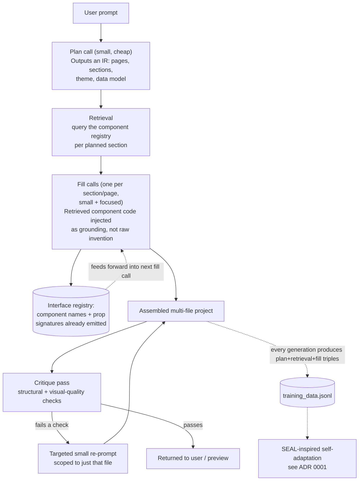

# Grounded Scaffold Generation (GSG)

*A technique for getting Bolt/Lovable-caliber output from a small (7B-class),
fully local model. Companion to `docs/PROJECT_SCOPE.md`,
`docs/adr/0001-seal-inspired-self-adaptation.md`, and
`docs/SEAL_SELF_ADAPTATION_DESIGN.md`.*

## 0. Prior art check first, honestly

Before treating this as novel, it's worth being precise about what already
exists, because the honest answer is more useful than an inflated one:

- **Registry-grounded generation** — assembling UI from a pre-built,
  tagged component registry instead of asking an LLM to invent markup from
  a style guide in its prompt — was directly evaluated against
  prompt-embedded and RAG-snippet approaches in a CHI 2026 paper
  ("Design System-Compliant User Interface Generation with LLM Agents").
  Registry-based won on compliance (95.08%) with only moderate overhead.
  This is not a hypothesis - it's a measured result.
- **Intermediate-representation scaffolding** — having the model build a
  structured plan (storyboard/data-model/screen-skeleton) before code, so a
  single prompt never has to hold "the whole app" at once — is Apple's
  **Athena** (IUI 2026). Users preferred it 3:1 over a chatbot baseline for
  prototyping.
- Both papers use frontier-scale hosted models. Athena targets SwiftUI.
  Neither addresses **small (sub-10B) models**, **fully local inference**,
  or **consumer/gaming-laptop hardware** as a constraint.

**What Grounded Scaffold Generation actually is:** combining both validated
techniques, purpose-built for the constraint neither paper had to solve -
squeezing Bolt/Lovable-caliber output out of a model an order of magnitude
smaller than what those tools (and these two papers) assume, running on a
single consumer GPU. That combination, evaluated under this specific
constraint, plus feeding results back into continuous fine-tuning
(`docs/adr/0001...`), is the part that's actually new here - not the
individual ingredients.

## 1. Why a 7B model specifically struggles here

Two distinct weaknesses, not one, and they need different fixes:

1. **Design taste/completeness** - a 7B model knows React/Tailwind syntax
   fine; what it lacks is the depth of exposure to "what does a genuinely
   good SaaS dashboard look like, in detail" that a frontier model gets
   from vastly more training data. No amount of prompting invents taste
   the weights don't have.
2. **Long-range coherence** - asking for an entire multi-file app in one
   completion taxes a small model's attention across a long generation;
   quality and consistency (prop names, import paths, repeated design
   decisions) visibly degrade the further into the generation it gets,
   and it's the direct cause of the truncation issues fixed earlier this
   session (`docs/CHANGELOG.md`, Session 1).

Registry grounding attacks (1): stop asking the model to invent good
design, give it good design and have it adapt/compose instead - a much
easier task for a small model. IR scaffolding attacks (2): stop asking for
the whole app in one shot, decompose into steps small enough that a 7B
model can reliably nail each one.

## 2. Architecture

### 2.1 The component registry (this is where the actual quality comes from)

**New:** `backend/component_registry/` - a curated, hand-picked or
hand-adapted (license-compatible) set of high-quality React + Tailwind
sections, organized by category:

- Navigation: navbar (3-4 variants), sidebar (2-3), tab bars
- Hero/landing: hero (4-5 variants: centered, split, with visual, minimal)
- Data display: stat/metric cards, data tables, charts (recharts
  wrappers), activity feeds, timelines
- Forms: auth forms, settings panels, multi-step forms, search/filter bars
- Commerce: product grids, cart, checkout steps, pricing tables
- Feedback: modals, toasts, empty states, loading/skeleton states

Each component is a real `.jsx` file plus a metadata entry (category,
style descriptors like `dark`/`minimal`/`bold`, a short natural-language
description) in a manifest, e.g. `backend/component_registry/manifest.json`.

**This library is the actual product asset.** It's where "looks like a
funded startup" comes from - not the model. Building and curating it well
matters more than any prompt-engineering choice in this whole document.

**Retrieval:** reuse the local lexical retrieval already in
`rag_engine.py` (`retrieve_project_context`) against the manifest
descriptions - no new infrastructure needed for v1. A small local
embedding model (anything that fits trivially in spare VRAM/RAM) is a
reasonable v2 upgrade for retrieval quality, not a v1 requirement.

### 2.2 Plan call (the IR, à la Athena)

One short, cheap completion. Output: compact JSON -
`{"pages": [...], "sections": [{"name", "type", "purpose"}], "theme": {...},
"dataModel": {...}}`. `type` maps directly onto registry categories for
retrieval in 2.1. This is a bounded, structured task - exactly what a 7B
model is reliably good at, unlike "invent a whole app."

### 2.3 Fill calls

One completion per page or logically-grouped set of sections, not one
giant completion for the whole app. Each fill call receives: the plan, the
retrieved registry components for its sections (as grounding to adapt, not
invent from), and a running **interface registry** - component names and
prop signatures already emitted by earlier fill calls, so cross-file
imports and prop contracts stay consistent without needing the whole
project in context at once.

The existing truncation-recovery loop (`generate_complete_response` in
`main.py`) and tolerant file parser stay in place underneath this as
safety nets - needed less often once individual calls are deliberately
scoped small, but not removed.

### 2.4 Critique-and-patch pass

After assembly: run existing structural checks (does it parse, does
preview render past tier-3 fallback) plus new visual-quality heuristics -
Tailwind utility class diversity above a threshold, more than one
component file, `lucide-react` usage present, no placeholder/TODO text. A
failed check triggers **one small, targeted re-prompt scoped to the
specific file** ("this file needs a stat-card pattern here - adapt this:
`<injected registry component>`"), not a full regeneration. This mirrors
the grader/feedback-agent pattern used in CAL-RAG (retrieval-augmented
layout generation with an evaluator + refinement agent), applied here at
much lower cost since each patch is small and targeted.

## 3. Feasibility on the target hardware

- More LLM calls than single-shot, but each is **smaller** - total token
  volume is comparable to (often less than) one giant call plus the
  truncation-continuation rounds it used to need.
- Retrieval is cheap (lexical, or a small local embedding model -
  negligible VRAM either way).
- No new heavy infrastructure: the registry is just files, retrieval reuses
  `rag_engine.py`, orchestration is more calls from `main.py`, not a new
  service.
- Calls are inherently sequential on a single local GPU (no multi-GPU
  parallelism to lean on) - worth measuring actual end-to-end latency
  against today's single-shot-plus-continuations approach once built,
  rather than assuming it's faster or slower.

## 4. Honest calibration

This narrows the gap to Bolt/Lovable; it does not close it. A model that's
adapting good, pre-built patterns to a specific request will reliably
produce more polished, more complete output than one inventing from a
blank page - but on a genuinely novel request outside the registry's
coverage, or one requiring real creative synthesis, a 7B local model
adapting familiar patterns will still show its ceiling compared to a
frontier model reasoning from a much broader base. That's fine - the
target defined in `docs/PROJECT_SCOPE.md` §4 (polished front-ends for
common business-app archetypes) is exactly the regime where a well-built
registry has strong coverage.

## 5. Connection to the self-adaptation pipeline (ADR 0001)

Every generation under GSG naturally produces a **(plan, retrieved
components, filled code)** triple - structured training data, richer than
raw prompt→code pairs. Combined with the self-edit capture already
designed in `docs/SEAL_SELF_ADAPTATION_DESIGN.md`, this gives two
concrete, fine-tunable objectives to specialize the model for over time,
narrower and more learnable than "generate a good app from scratch":
getting better at the **plan** step, and getting better at **adapting** a
retrieved pattern rather than inventing one. This is the specific
research angle worth writing up (see `docs/NOVELTY_AND_IP_ASSESSMENT.md`,
updated): fine-tuning a small local model specifically for
registry-grounded composition, evaluated against raw single-shot
generation, under a hard consumer-hardware compute budget - a combination
not covered by either of the papers this design builds on.

## 6. Build order (do not build all of this before testing the first slice)

1. **Registry + retrieval only**, plan/fill calls unchanged from today's
   single-shot generation for now - just inject 3-5 retrieved components
   into the existing prompt as extra grounding. Cheapest possible slice;
   tests whether registry-grounding alone measurably improves output
   before investing in the multi-call orchestration.
2. **Add the plan call and per-page fill decomposition** once (1) shows
   signal - this is the bigger engineering lift (interface registry,
   multi-call orchestration in `main.py`) and should be justified by
   evidence from (1), not built on faith.
3. **Add the critique-and-patch pass** last - it depends on (2) producing
   assembled multi-file output to check in the first place.
4. Evaluate each step against the Phase 1 eval harness
   (`docs/PROJECT_SCOPE.md` §8 / `docs/SEAL_SELF_ADAPTATION_DESIGN.md` §4)
   so "did this actually help" is measured, not assumed.
