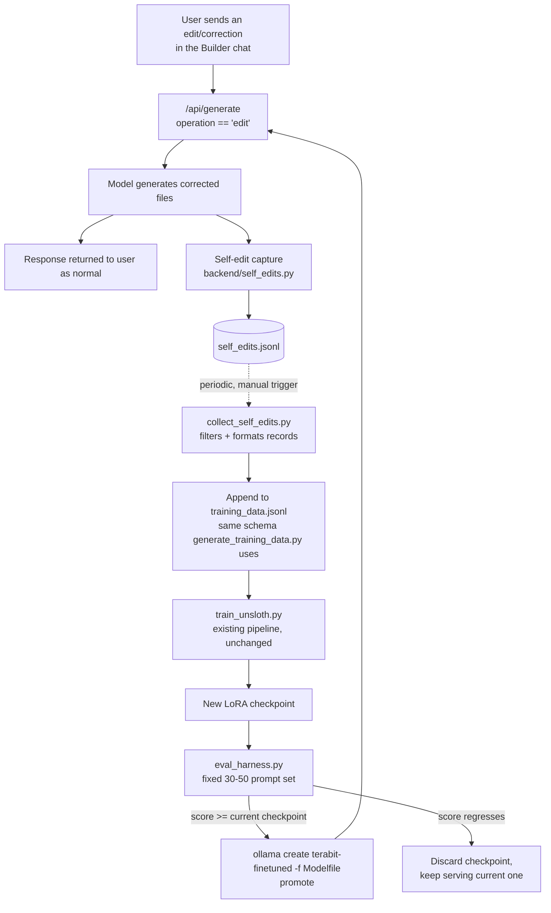

# System Design: SEAL-Inspired Self-Adaptation Pipeline

*Companion to `docs/adr/0001-seal-inspired-self-adaptation.md`. That ADR
explains what's being built and why (a scoped-down alternative to full SEAL);
this document is the actual build spec.*

## 1. Goal

Turn real user corrections inside the Builder into new LoRA training data
automatically, batch-retrain on the existing Unsloth pipeline, and only
promote a new checkpoint if it measurably improves on a fixed eval set —
closing the loop from "user fixes something" to "model does it right next
time" without any manual dataset curation, and without the RL/online-update
machinery full SEAL requires (see ADR 0001 for why that's out of scope on
this hardware).

## 2. Data flow



The only new *runtime* component is the capture step (E) — everything after
the dotted line is an offline batch process you run when you choose to,
not something that fires automatically while you're using the app.

## 3. Component 1 — Self-edit capture (new, small)

**File:** `backend/self_edits.py` (new)

Hooked into the existing `/api/generate` handler in `main.py`, only on the
`operation == "edit"` path (the `operation == "create"` path has no prior
output to correct against, so there's nothing to capture there).

```python
def record_self_edit(
    correction_request: str,
    project_context: str,      # from the existing retrieve_project_context()
    corrected_files: list[dict],
    session_id: str,
) -> None:
    """Append one training-candidate record. Cheap, synchronous, best-effort -
    never raise into the request path; a failed write here should never
    break a generation."""
```

This should reuse **whatever record schema `generate_training_data.py`
already writes to `training_data.jsonl`** — don't invent a second schema.
Read that file's output format first and match it exactly, so
`collect_self_edits.py` (below) can literally concatenate the two files.
Call `record_self_edit(...)` right after a successful edit-operation
response in `main.py`, wrapped in `try/except` so a filesystem hiccup can
never surface as a user-facing error.

## 4. Component 2 — Batch collection & promotion gate (new)

**File:** `backend/collect_self_edits.py` (new, run manually — `python
backend/collect_self_edits.py`)

1. Read `self_edits.jsonl`, drop obviously-bad records (empty
   `corrected_files`, corrections shorter than a few words, exact
   duplicates).
2. Append the survivors to `training_data.jsonl` in the existing schema.
3. Print a summary (`N new records added, M skipped`) and stop — actually
   kicking off `train_unsloth.py` stays a separate, explicit step, so a
   laptop doesn't unexpectedly start a fine-tuning run mid-workday.

**File:** `backend/eval_harness.py` (new)

- A fixed list of 30-50 prompts spanning the business-app archetypes in
  `docs/PROJECT_SCOPE.md` §4 (dashboard, CRM, storefront+admin, booking
  tool, analytics view), checked into the repo (e.g.
  `backend/eval_prompts.json`) so the set is stable across runs — an eval
  set that changes between comparisons isn't a comparison.
- For a given model tag, runs each prompt through `/api/generate`, and
  scores each result on things that are cheap to check automatically:
  - **Structural success:** did `parse_generated_files` produce a non-empty
    file set; does `preview_builder.build_preview_html` produce a tier-1 or
    tier-2 preview (not the tier-3 fallback); does the entry file actually
    call `createRoot`/`ReactDOM.render`.
  - **Visual-quality proxy (cheap, not a real substitute for human eval,
    but useful as a regression guard):** presence of Tailwind utility
    classes beyond a trivial count, presence of more than one component
    file, presence of `lucide-react` icon usage, absence of `TODO`/
    placeholder text.
  - Optionally, an LLM-judge pass (ask a stronger model — could be this
    same Claude session, called manually, or any hosted model you have API
    access to — to score a handful of generated screenshots/files against
    a rubric). Worth adding once the cheap structural checks are in place
    and stable; don't build this first.
- Compares a candidate checkpoint's aggregate score against the currently
  served checkpoint's score (re-run periodically, not just once, since the
  eval set doesn't change but the current-checkpoint baseline should be
  refreshed if the prompt set or scoring logic changes).
- **Promotion is a manual, printed recommendation, not an automatic
  action** for v1: `eval_harness.py` should print something like
  `candidate scores 34/50 vs current 29/50 - looks like an improvement.
  To promote: cd models && ollama create terabit-finetuned -f Modelfile`.
  Auto-promotion is a reasonable v2 once the scoring is trusted.

## 5. What does *not* change

- `train_unsloth.py` — reused as-is. This design's entire point is to
  feed it better/more real data, not replace it.
- `rag_engine.py`'s generation prompt — unchanged by this feature. (It was
  already restored to the quality-focused version this session; that's an
  orthogonal fix.)
- The Ollama `ADAPTER`-based serving path already built
  (`models/Modelfile`, `MODEL_NAME` in `.env`) — checkpoint promotion is
  just re-running `ollama create` with the same name, which is exactly
  how the existing setup was already documented to handle retraining
  (see the comment in `models/Modelfile`).

## 6. Explicitly out of scope for this design

- Any online/per-request weight update (true test-time adaptation) — see
  ADR 0001, Alternatives Considered.
- A learned self-edit-writing policy (SEAL's actual RL loop) — this design
  substitutes a single offline eval-gated promotion for that; see ADR 0001,
  Consequences.
- Automatic, unattended retraining — every stage that spends real compute
  (`collect_self_edits.py`'s follow-up training run, checkpoint promotion)
  stays a deliberate, manual command for v1.

## 7. Rollout plan

1. Ship `self_edits.py` capture only, behind no flag (it's inert — just
   appends to a file) — start accumulating real signal immediately, even
   before the rest of the pipeline exists.
2. Once `training_data.jsonl` has meaningfully more real-usage records
   (a few hundred, not the ~20-30 the current checkpoint trained on —
   see `docs/CHANGELOG.md`, Session 2), build `eval_prompts.json` and
   `eval_harness.py` and get a real baseline score for the *current*
   checkpoint before training anything new — you need a "before" number
   for "after" to mean anything.
3. Run `collect_self_edits.py` → `train_unsloth.py` → `eval_harness.py` as
   a manual loop, and only then consider automating any part of it.
