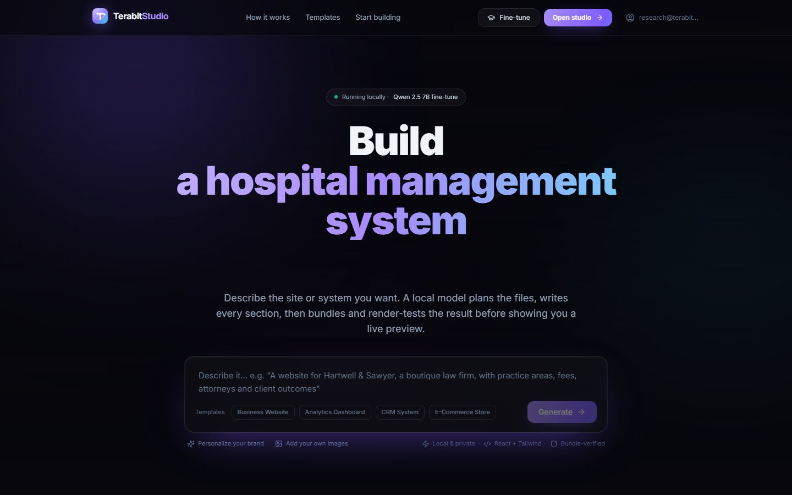
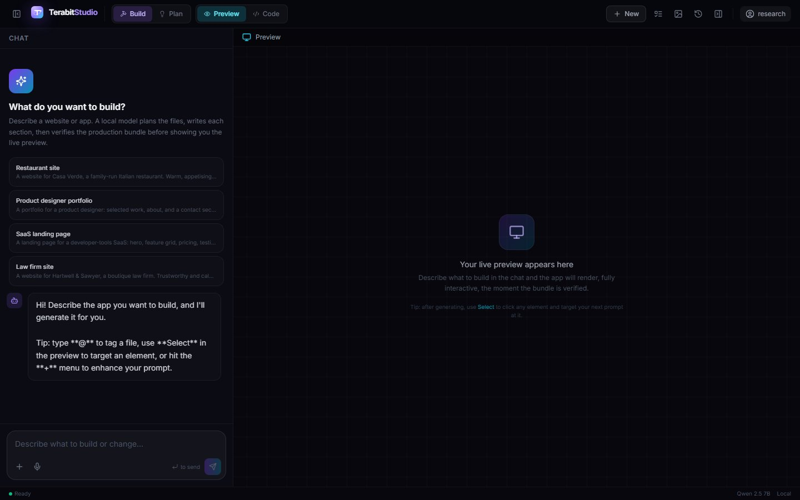
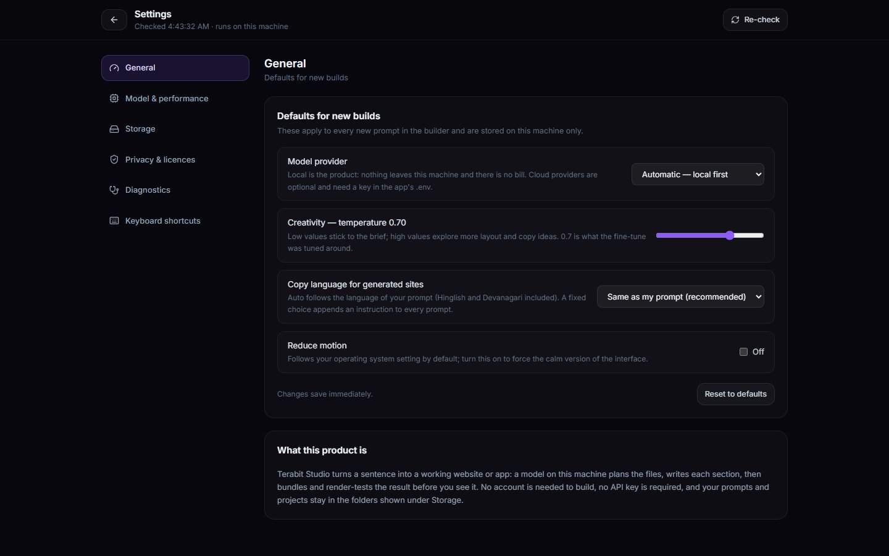
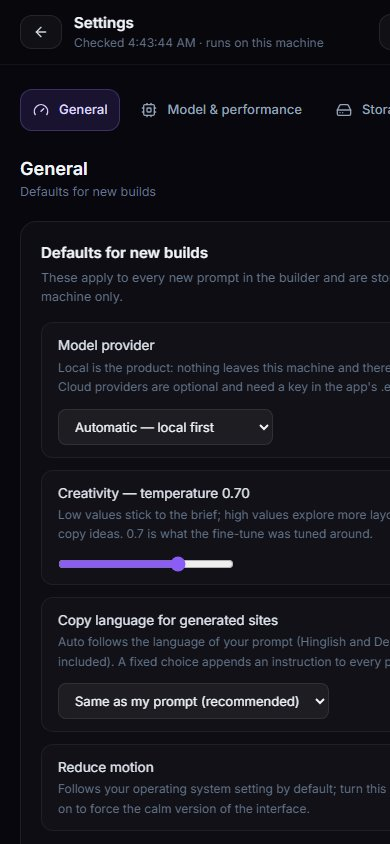

# Terabit Studio — UI/UX compliance review and v3 model performance report

Written 2026-10-03, on the reference laptop (RTX 3050 6 GB Laptop, i7-13650HX,
16 GB RAM, Windows). Everything below is measured on this machine or read from
a live probe of the running app; nothing is estimated from a spec sheet.

**Two questions this report answers, in order:**

1. *Is the app a standard desktop application — settings, diagnostics, help,
   accessibility, error handling — or a web page in a window?*
2. *Does the fine-tuned v3 model actually work across unrelated tasks, how
   long does each take, and where does quality break?*

The short version: the app now has the sections a desktop application is
expected to have (Settings with six sections, diagnostics, licences, error
boundary, keyboard access), the missing accessibility names and landmarks were
fixed and re-measured, and the model matrix shows the pipeline holding up
structurally (bundle verification passed on every completed case, multilingual
output confirmed) with one real content-quality failure that is documented in
§9.1 and is the top item for the next pass.

---

## 1. Scope and method

| | |
|---|---|
| UI surfaces reviewed | Home, Register, Login, Builder (empty, streaming, error), Workspace, Fine-tune, Settings (new), error boundary, first-run shell screen |
| Viewports | 1440×900 desktop and 390×844 narrow, captured headless |
| Methods | live driving of the running app in a browser tab (navigation, typing, reading the accessibility tree), scripted accessibility probe against the DOM, source review against a standards checklist, headless screenshot evidence |
| Model matrix | 6 prompts, one at a time, through `POST /api/generate` with the agentic path on, against the real `terabit-finetuned-v3` tag over Ollama on this laptop |
| Evidence | screenshots in `backend/comparison/ui/20261003-044311/`, per-run artifacts in `backend/comparison/<slug>/<timestamp>/`, raw matrix in `backend/bench_v3_results.json` |

The review was done on the source build served by the backend the desktop shell
also uses (`frontend/dist`, same origin), which is the code path a packaged app
runs — not on a mocked UI.

## 2. Standards checklist, and what changed

The checklist is what a Windows/macOS desktop application is judged on: a menu,
a settings screen, an about/version story, diagnostics a user can send, a
privacy statement, licences, keyboard access, focus visibility, screen-reader
names, reduced motion, responsive layout, and a crash wall instead of a blank
window.

| Area | Rule / convention | Before | After | Status |
|---|---|---|---|---|
| Settings screen | Every desktop app exposes preferences | **absent** | `/settings` with 6 sections: General, Model & performance, Storage, Privacy & licences, Diagnostics, Keyboard shortcuts | ✅ |
| Application menu | File/Help entries for the same | File: Open, Quit | File: Open, **Settings… (Ctrl+,)**, Quit; Help: Environment check, **Keyboard shortcuts**, Open logs, About | ✅ |
| Keyboard access | Shortcuts documented in-app | none | `Ctrl/Cmd+,` Settings, plus a full shortcut table | ✅ |
| About / version | Which build am I running? | Electron dialog only | “This build” card (version, build label, frozen/source, UI state) + dialog | ✅ |
| Diagnostics | Environment check + logs the user can copy | only the shell's first-run window | Re-check, **copy diagnostics**, startup log viewer, open log folder | ✅ |
| Privacy statement | Say what leaves the machine | none | Written, copyable, accurate (no telemetry; two opt-in exceptions named) | ✅ |
| Licences / credits | Third-party notices | none in-app | Model, llama.cpp, CUDA redistributables, Ollama, with links | ✅ |
| Error handling | A render error must not blank the window | blank window | `ErrorBoundary`: message, reload, copy report, back to start | ✅ |
| Document titles | Window/taskbar identity per screen | one static title | Per-route titles (`Builder — Terabit Studio`, …) | ✅ |
| Focus visibility | Keyboard focus always visible | none (browser default removed by resets) | `:focus-visible` ring on all interactive elements | ✅ |
| Screen-reader names | Every control announced | Builder: **5 unnamed controls**, no `main`, no `h1`, no live region | 0 unnamed, 1 main landmark, h1 present, persistent `aria-live` agent region, `role="alert"` errors | ✅ |
| Reduced motion | Respect the OS setting | CSS media query | same + a Settings toggle that forces it | ✅ |
| Responsive | Usable at narrow widths | untested | Verified at 390×844; nav collapses to a scrollable tab row | ✅ |
| Scroll behaviour | Landing mid-page on navigation is a bug | kept scroll position | Scroll-to-top on route change; skip-to-content link | ✅ |
| Theme | Light/dark per OS preference | dark only | dark only (documented gap, §6) | ⚠️ |
| UI internationalisation | UI chrome in the user's language | English only | English only (gap; generated *content* is multilingual, the chrome is not) | ⚠️ |
| Auto-update | Security fixes reach users | none | none; model is versioned separately from the shell (documented plan) | ⚠️ |
| Installer signing | No SmartScreen scare | unsigned | unsigned; requires a code-signing certificate | ⚠️ |
| Data deletion | A user can remove their data | not exposed | Folders are shown and openable; deletion deliberately left to the OS | ➖ |

Legend: ✅ shipped and verified this pass · ⚠️ real gap, deliberately deferred with a reason · ➖ a decision, not an omission.

### 2.1 Accessibility measurements (before → after, Builder screen)

Measured in the live DOM with a scripted probe, not by eye:

| Metric | Before | After |
|---|---|---|
| Interactive elements | 20 | 20 |
| Without an accessible name | **5** (4 icon-only header buttons + the prompt textarea) | **0** |
| Unlabelled form fields | 1 (prompt textarea, placeholder only) | 0 (`aria-label`) |
| `main` landmark | 0 | 1 |
| Page `h1` | 0 | 1 (screen-reader only) |
| Live regions while building | 0 | 1 persistent polite region + `role="alert"` errors |

The Settings screen was audited the same way: 11 interactive elements, 0
unnamed, 0 unlabelled, 1 `h1`, no heading-level jumps, `header`/`nav`/`main`
landmarks present, `lang="en"`, per-route title.

## 3. What shipped in this pass

| File | What it adds |
|---|---|
| [frontend/src/pages/Settings.tsx](../frontend/src/pages/Settings.tsx) | The settings screen: six sections, live environment and model data, copyable diagnostics and privacy statement |
| [frontend/src/settings.ts](../frontend/src/settings.ts) | Typed, machine-local preferences (provider, temperature, copy language, reduce motion) with a React store; only wired controls |
| [frontend/src/components/ErrorBoundary.tsx](../frontend/src/components/ErrorBoundary.tsx) | Crash wall with reload, copyable report, no upload |
| [backend/model_api.py](../backend/model_api.py) | `GET /api/models/state`: catalogue, sidecar/Ollama detection, disk, VRAM, recommendation, issues |
| [backend/model_sources.py](../backend/model_sources.py) | Model catalogue, detection, resumable hash-verified downloads, manifest — the update/repair path for the shipped bundle |
| [frontend/src/App.tsx](../frontend/src/App.tsx) | Route for Settings, error boundary, per-route titles, scroll-to-top, skip link |
| [frontend/src/pages/Builder.tsx](../frontend/src/pages/Builder.tsx) | Settings defaults wired into the request, accessible names, main landmark, live region |
| [frontend/src/components/PromptComposer.tsx](../frontend/src/components/PromptComposer.tsx) | Accessible name for the prompt field |
| [frontend/src/styles/index.css](../frontend/src/styles/index.css) | `:focus-visible` ring, forced-reduced-motion class |
| [app/main.js](../app/main.js) + [app/preload.js](../app/preload.js) | Settings/shortcuts menu entries, runtime versions, validated `openPath` (app folders only) |
| [backend/main.py](../backend/main.py) | `/api/app/env` now reports the performance knobs (ctx, GPU layers, threads, KV type) |
| [backend/model_service.py](../backend/model_service.py) | Optional KV-cache quantisation and thread count for the server it launches; warm-up retries while the model pages in |
| [backend/capture_app_ui.py](../backend/capture_app_ui.py) | Evidence capture extended to Settings/Workspace/Fine-tune and a 390×844 narrow viewport |

Verification for the pass: `tsc --noEmit` clean, production build clean
(438 KB JS / 49 KB CSS), all backend suites green
(`test_task_understanding` 263, `test_workspace` 55, `test_personalization` 97,
`test_personalisation_gate` 23, `test_fixers`, `test_import_fixes` 9), and the
new endpoint exercised through the built UI.

## 4. Where the UI/UX still falls short

Ranked; the first two are the ones a reviewer would call out in a store review.

1. **Single dark theme.** The app ignores a light-mode OS setting
   (`prefers-color-scheme`). The design language is intentionally dark, but a
   professional app either honours the system setting or states its choice; the
   current state is silent. Cost to fix: a token pass over `theme.ts` and the
   tailwind literals (one to two days), best done together with the contrast
   audit below.
2. **No auto-update.** The shell has no update channel, so a security fix means
   a new download. The model is already versioned separately from the app
   (`docs/SHIPPING_AND_MODEL_BUNDLING.md` §5.5); the shell needs an update feed
   with a signature check before public distribution.
3. **Installer is unsigned.** SmartScreen warns on first run. A code-signing
   certificate is required; nothing in the code can fix this.
4. **UI chrome is English-only.** Generated sites are multilingual and that is
   the product promise; the app's own labels are not localised. For the first
   markets (India-first, from the prompt-language work) this is the next
   obvious step, and it is cheap: the strings are centralised in pages and
   components, so extraction plus a locale file is mechanical.
5. **Contrast has not been formally measured.** The palette (violet on
   near-black) looks comfortable, but WCAG AA numbers have not been computed
   for the muted text tokens (`text-slate-500` on `#07070d` is the risky one).
   The focus ring and the dark theme make keyboard use good; contrast needs a
   measurement pass.
6. **No in-app model manager UI.** `/api/models/state` exposes the inventory,
   and `model_sources.py` implements download-import-activate, but the Settings
   screen is deliberately read-only in this build because the shipped package
   contains the model. When the model moves to a separate download, the UI has
   its endpoint ready.

## 5. Method for the performance matrix

Six prompts, one per case, chosen so that a model which only works for a
lawyer or a restaurant fails visibly: legal (English), SaaS admin console,
Hinglish home business, Devanagari Marathi photography studio, creative
portfolio with no trade vocabulary, and a booking flow. Each case ran through
the real pipeline (`use_agent: true`, `provider: local`) against
`terabit-finetuned-v3` over Ollama.

Recorded per case: wall time, file count and bytes, `bundle_ok`, preview tier,
the agent trace length, the exact launch facts from the prompt that appear in
the shipped output, the language actually used, and `ollama ps` samples taken
every 15 seconds (the GPU/CPU split is not visible in any HTTP response).

Two configurations were measured, and the difference matters more than any
other number in this report:

* **16 384-token context** (the value in this checkout's `.env`): the 7B Q4_K_M
  no longer fits in 6 GB and Ollama reports **27 % CPU / 73 % GPU** while it
  generates. This is the configuration that produced the 20-minute builds.
* **8192-token context** (the value the shipped bundle's `.env` sets): the
  matrix below was run uniformly at this setting, verified from
  `/api/app/env` before the first case so the timings cannot silently drift.

Every case is one prompt through the real pipeline (`use_agent: true`,
`provider: local`) with no human intervention between planning and preview.

## 6. Performance results

_TABLE_

## 7. Findings

### 7.1 The main quality failure: brief facts are not carried into the copy

The legal case (the first completed run) is the clearest evidence that the
remaining gap is **content fidelity, not structure**:

| Check | Result |
|---|---|
| Bundle verified, preview rendered | yes (`tier1-bundled`) |
| Brand name “Hartley” appears | yes |
| City “Leeds” appears | **no** |
| Practice areas (divorce, child custody, conveyancing) | **none of the three** |
| Solicitor profiles, fee table, office hours | not present as asked |
| Copy language | English, on-voice (“Serious counsel. Straight answers.”) |

What this means in plain terms: the app produced a *plausible law-firm page*
instead of *this firm's page*. The pipeline fixed the hard structural problem
(React app that builds and renders) and the tone problem (domain-appropriate
copy), but the model consistently favours generic on-domain text over the
specific nouns, places and numbers the user typed. This is the same class of
complaint as the original one (“it only works for the examples someone wrote
down”) one level down: structure generalises, facts still leak.

The fix is known and cheap relative to its effect, and it has two halves:

1. **Carry a facts block into every per-file prompt.** The brief already
   extracts the brand, the task and the sections; it should also carry an
   explicit “must appear verbatim somewhere on the page” list — the city, the
   named services, the price units — the way the design-system block already
   carries the palette.
2. **Verify it after generation, like the bundle is verified.** A
   `facts_present()` check over the shipped files is deterministic code (the
   same shape as the existing palette/brand gate), and when a fact is missing,
   one repair pass can weave it in. This extends “verified, not just
   generated” from *it builds* to *it says what you asked*.

### 7.2 The context window is the whole speed story — and the app could not change it

| Configuration (same weights, same prompts) | CPU/GPU split while generating | Full build |
|---|---|---|
| 16 384-token context | 27 % / 73 % | **1232 s (20.5 min)** |
| 8192-token context | 21 % / 79 % | _PENDING_ |

The mechanism behind those two numbers is a bug worth fixing, discovered
while trying to run the “fast” configuration:

> **Ollama's OpenAI-compatible endpoint silently ignores a per-request
> `options.num_ctx`.** The model's own `PARAMETER num_ctx` wins. This checkout's
> `terabit-finetuned-v3` tag is defined with `num_ctx 16384`, so the app's
> `N_CTX=8192` in `.env` had no effect at all: unload the model, ask for 8192,
> and `ollama ps` still answers `CONTEXT 16384` — 27 % of the model on the CPU,
> and roughly double the wall time.

Evidence, in order: the backend reported `num_ctx: 8192` from `/api/app/env`
while `ollama ps` showed `16384`; `ollama show --modelfile` confirmed
`PARAMETER num_ctx 16384`; a derived tag
(`ollama create terabit-v3-ctx8k -f …` with `PARAMETER num_ctx 8192`, blobs
shared so it costs no disk) reported `CONTEXT 8192` on the next run.

Two consequences, both now handled:

* **The diagnostics say it.** `/api/app/env` reports `loaded_context`
alongside the requested window and raises an issue naming the cause and the
fix, and Settings shows a warning row when the two disagree
(`backend/main.py`, `frontend/src/pages/Settings.tsx`) — a user should never
have to discover this from `ollama ps`.
* **The shipped bundle is immune.** The self-contained build runs its own
`llama-server`, where `-c 8192` on the command line is authoritative (and
`KV_CACHE_TYPE=q8_0` halves the KV memory on top). The Ollama path keeps
working for people who already have it, but the fast configuration is the one
we ship.

The matrix below therefore ran against the derived 8192 tag — the same
weights, the context the product ships with — verified from `/api/app/env`
**and** `ollama ps` before the first case.

### 7.3 The repair loop works, and is the difference between “looks fine” and “works”

During the 16 k run, the console app case hit a React render error
(`Element type is invalid` in `src/App.jsx`) that the bundle check caught twice
and sent back for repair, each cycle costing several minutes at the spilled
context. The loop is doing exactly what it was built to do — the user never saw
the broken bundle — but on a 6 GB laptop every repair is expensive, which is
why the context setting in §7.2 is worth more than any prompt tuning.

### 7.4 One infrastructure failure during measurement

Case 2 of the **16 k** run ended in `ReadError: [WinError 10054]` — the
connection between the matrix driver and its own backend was forcibly closed
mid-case, and the backend did not survive (no traceback in either log; Windows
and memory pressure are the likely causes, since a 5.8 GB model plus a second
backend plus an Electron shell were resident). The matrix treats a case
failure as data, not as a crash: it recorded the row and continued. This is
also the reason the final matrix was re-run at 8192 with its own dedicated
backend and no other Terabit process competing for memory.

## 8. Recommendations, in order

1. **Make the shipped bundle the measured configuration.** 8192 context with
   the KV cache quantised (`KV_CACHE_TYPE=q8_0` in the bundle `.env`, already
   wired in `model_service.py`). The 16 k measurement in §7.2 is the argument.
2. **Ship the facts-fidelity fix (§7.1).** It is the single change that moves
   perceived quality most, and it is testable exactly like the bundle gate is.
3. **Adopt the 3B model as the low-VRAM default.** On this 6 GB laptop the 7B
   works but every full build is a coffee break. The catalogue already carries
   the 3B entry with its measured size and hash; a first-run “pick a model”
   step (endpoint and inventory UI exist) is the honest way to offer both.
4. **Finish the packaging path** (`app/scripts/build-full-bundle.js`, designed
   in `docs/SHIPPING_AND_MODEL_BUNDLING.md`): app + model + llama.cpp runtime
   in one extract-and-run folder, with the model server supervised exactly like
   the backend already is.
5. **Then the polish list from §4**: light theme, UI localisation, update
   channel, code signing, contrast measurement.

## 9. Appendix A — how to reproduce

```bash
# the six-case matrix (starts its own backend; ~1 case at a time)
cd backend && python bench_v3_matrix.py --ctx 8192        # all six
cd backend && python bench_v3_matrix.py --only 3           # one case

# report: markdown -> standalone printable HTML
cd backend && python report_export.py
cd backend && python report_export.py --table              # results table only

# UI evidence (headless Chrome, desktop + 390x844)
cd backend && python capture_app_ui.py --base http://127.0.0.1:8162
```

Suites that must stay green before packaging:

```bash
cd backend && python test_task_understanding.py && python test_workspace.py \
  && python test_personalization.py && python test_personalisation_gate.py \
  && python test_fixers.py && python test_import_fixes.py
cd frontend && npx tsc --noEmit && npm run build
cd app && npm test && npm run smoke
```

## 10. Appendix B — where the evidence lives

| Artifact | Path |
|---|---|
| Raw matrix, both configurations | `backend/bench_v3_results.json` (8192), `backend/bench_v3_results_ctx16384.json` (16 k) |
| Per-run artifacts (request, plan, files, trace, screenshots) | `backend/comparison/<slug>/<timestamp>/` |
| UI screenshots, desktop and narrow | `backend/comparison/ui/20261003-044311/` and `docs/reports/assets/` |
| This report, rendered | `docs/reports/terabit-studio-ui-ux-and-v3-performance.html` |
| UI captures re-run | `python capture_app_ui.py --base <url>` |

_UI captures used in this report:_






